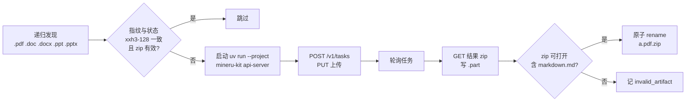

# mineru-ocr

递归扫描本地 PDF 与 Office 文档，自己拉起一个本地 [MinerU](https://github.com/opendatalab/MinerU) 服务逐个解析，把产物 zip 落在源文件旁边；靠每个目录一份状态文件做增量跳过。



## 它做什么

- 一个二进制、一条命令：`mineru-ocr <root>...`
- 服务生命周期由本程序负责：挑空闲端口、启动、等就绪、运行期健康检查、Ctrl+C 清理残留
- 每文件一个 MinerU task；客户端并发数同时作为服务端 `--concurrency`
- PDF 走 `--tier`（默认 `advanced`），Office 四类由服务端强制 `flash`
- 结果不落数据库：`<源文件>.zip` + `<root>/.mineru-state.json`

**不做**：解压产物、直接输出 markdown、常驻 watch、连接远程或已有服务实例。

## 依赖

| 依赖 | 说明 |
|---|---|
| Linux | 进程控制（进程组、`/proc`、信号）只实现了 Linux；其他平台启动即退出 2 |
| [uv](https://docs.astral.sh/uv/) | 所有 Python 侧执行都经 `uv run --project`，不调用裸 `python`/`pip` |
| MinerU 项目 | 需要 `mineru-kit` 子命令；默认取 `$MINERU_PROJECT`，否则 `$HOME/Projects/MinerU` |
| 本地模型 | 首次使用前：`uv run --project <MinerU> mineru-kit models download` |
| GPU | `advanced` 档跑本地 VLM，实际使用建议有 NVIDIA GPU（纯 CPU 会很慢） |

Go 1.27+ 用于自行编译。

## 构建与安装

```bash
task build            # 产出 ./bin/mineru-ocr
# 或者
go build -trimpath -o bin/mineru-ocr ./cmd/mineru-ocr
```

## 使用

```bash
# 先看计划，不启服务、不写状态
mineru-ocr ~/docs --dry-run

# 正常跑：产物落在每个源文件旁边
mineru-ocr ~/docs ~/papers/report.pdf

# 机器可读报告 + 指定服务端口
mineru-ocr ~/docs --json --port 18081 > report.json

# MinerU 仓库不在默认位置
MINERU_PROJECT=~/src/MinerU mineru-ocr ~/docs
```

第二次运行同一批文件会全部跳过；删掉某个 `.zip` 或改动了源文件，只重做那一个。

### 参数

| flag | 默认 | 说明 |
|---|---|---|
| `--workers` | `2` | 客户端并发文件数，同时作为服务端 `--concurrency` |
| `--tier` | `advanced` | PDF 解析档位（`advanced`/`basic`/`standard`/`flash`），透传给服务端 |
| `--mineru-project` | `$MINERU_PROJECT` → `$HOME/Projects/MinerU` | `uv run --project` 的目标 |
| `--port` | `0` | 服务端口；`0` 自动挑空闲端口 |
| `--dry-run` | 关 | 只扫描并打印计划 |
| `--json` | 关 | stdout 输出 JSON 报告，而不是汇总表 |
| `--verbose` | 关 | 预留：细节日志尚未接线（见“已知限制”） |
| `--service-log` | `<首根>/.mineru-service.log` | 服务端 stdout+stderr 落盘，每次运行覆盖 |
| `--no-service-log-stream` | 关 | 关闭服务日志的实时透传（文件照写） |

优先级：**flag > 环境变量 > 内置默认**。没有配置文件。

### 退出码

| 码 | 含义 |
|---|---|
| `0` | 全部成功，或无事可做 |
| `1` | 至少一个文件失败 |
| `2` | 致命：参数非法、服务启动/就绪失败、运行中服务失联、端口无法分配、平台不支持 |
| `130` | 用户中断（Ctrl+C）：取消在飞任务、关停服务后退出 |

进度与错误走 **stderr**，每文件一行：

```
[3/42] ok   report.pdf  12.3s
[4/42] FAIL scan.docx  parse_failed: ...
```

服务端日志同时实时透传到 stderr，逐行加 `[service] ` 前缀；汇总表（或 `--json` 的 JSON）走 stdout。

## 产物与状态

- 产物：`<源文件>.zip`（例如 `a.pdf.zip`），内含 `markdown.md` 等 MinerU 输出；先写 `.part`，校验通过后原子 rename
- 状态：每个根一份 `.mineru-state.json`

```json
{
  "schema_version": 1,
  "tool_version": "0.1.0",
  "files": {
    "/home/me/docs/a.pdf": {
      "size": 123456,
      "hash": "<xxh3-128，32 位十六进制>",
      "tier": "advanced",
      "zip_path": "/home/me/docs/a.pdf.zip",
      "status": "completed",
      "error": null,
      "duration_ms": 12340,
      "updated_at": "2026-11-08T20:00:00+08:00"
    }
  },
  "service": null
}
```

跳过条件（三条全满足）：`status == "completed"`、指纹一致、`zip_path` 存在且能以 zip 打开并含 `markdown.md`。

只持久化终态；不存 in-flight / task_id。写入是整体原子重写（`*.tmp` + rename）。JSON 解析失败时把旧文件备份成 `.mineru-state.json.bak`，以空状态继续并告警。

## 服务管理细节

- **启动**：`exec.LookPath("uv")` → 取空闲端口 → `uv run --project <project> mineru-kit api-server --port <p> --upload-dir <tmp>/mineru-ocr-<p> --tier <tier> --concurrency <workers> --preload-models`，子进程放进独立进程组（`Setpgid`）
- **就绪**：每 250ms 探 `GET /v1/health`（单次 1s 超时），上限 120s；连接被拒算未就绪
- **启动失败**：退出码 3 或日志含 `address already in use` → 换端口重试一次；`Unsupported tier` → 直接退出 2；其他 → 提示 `uv run --project <project> mineru-kit models download`
- **存活**：运行中每 5s 探一次健康，连续 3 次失败（服务已退出时健康检查同样失败）→ 停止派发、等在飞任务、退出 2
- **关停**：对进程组发 `SIGTERM` → 等 5s → 未退则 `SIGKILL` 整组 → 确认端口不再可连（≤5s）
- **残留清理**：启动前对状态文件里的 `service` 记录做三判据校验——pid 存活（`/proc/<pid>/stat` 的 state 非 `Z`/`X`）、记录的端口 `/v1/health` 返回 200、`/proc/<pid>/cmdline` 含 `mineru-kit`、`api-server` 与 `--port <port>`——三条同时满足才杀，否则只警告

## 开发

[go-task](https://taskfile.dev/) 承载全部入口：

| 任务 | 作用 |
|---|---|
| `task check`（默认） | `fmt:check` + `lint` + `test` |
| `task fmt` / `task fmt:check` | gofumpt 写入 / 只出 diff 且失败 |
| `task lint` | revive（配置见 `.golangci.yml`，经 golangci-lint） |
| `task build` | 产出 `bin/mineru-ocr` |
| `task test` | 单元测试（`httptest` 假服务，不依赖 GPU） |
| `task e2e` | 真实 MinerU 服务的端到端测试（`-tags=e2e`，需要 uv、项目与本地模型） |

规格与决策记录在仓库内的 issue tracker 里：`.scratch/mineru-ocr/spec.md`（可实施规格）、`map.md`（决策与取舍）、`issues/`（逐张工单）。术语见 [`GLOSSARY.md`](GLOSSARY.md)。

## 已知限制

- `--verbose` 只解析未接线，当前不会输出额外细节
- `advanced` 档由本程序通过启动参数保证；服务端若拒绝，逐文件 400 原样上报，不降级
- 自动端口是 `bind → close → 传参`，存在极小竞态，靠“启动失败换端口重试一次”兜底
- 残留识别依赖命令行匹配；`/proc` 读不到时按“不杀 + 警告”处理
- 只支持 `.pdf .doc .docx .ppt .pptx`，不能通过 flag 扩展；图片 OCR 不支持

## 许可证

[MIT](LICENSE) © 2026 Qxy0happy
